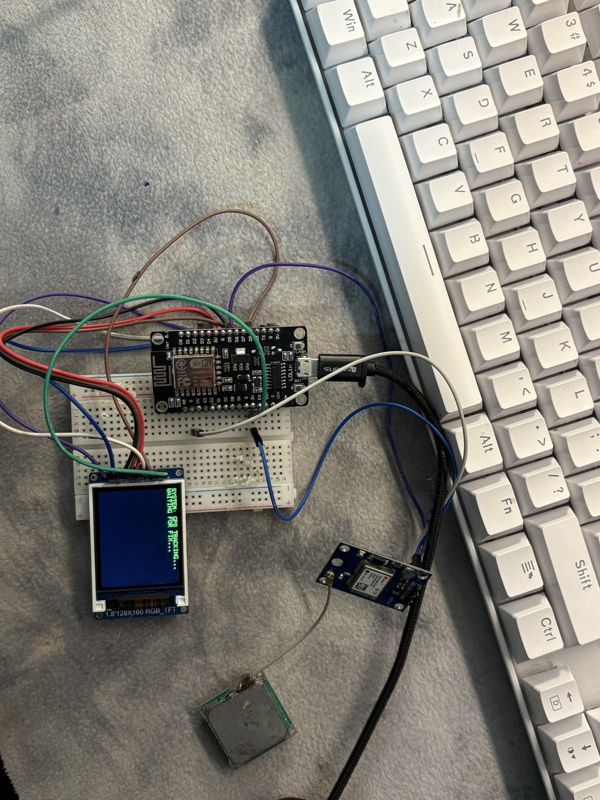
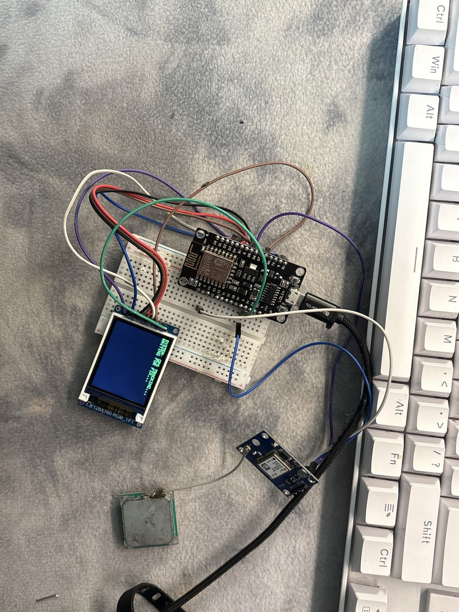
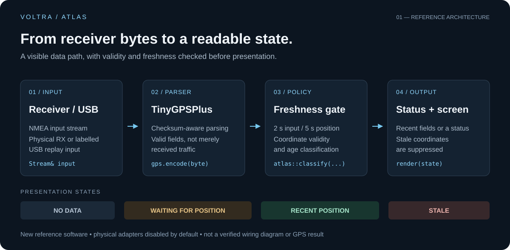
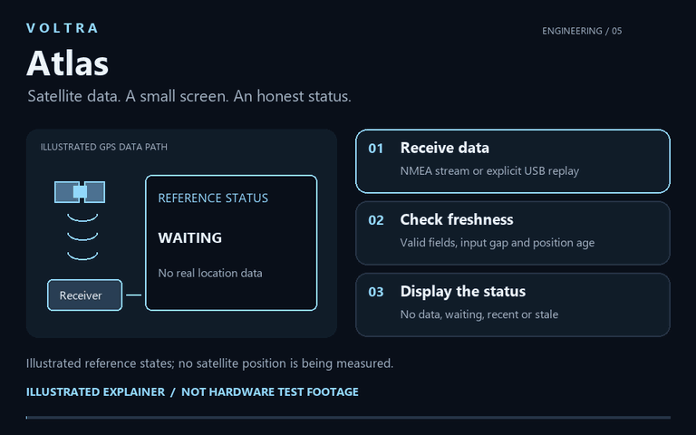
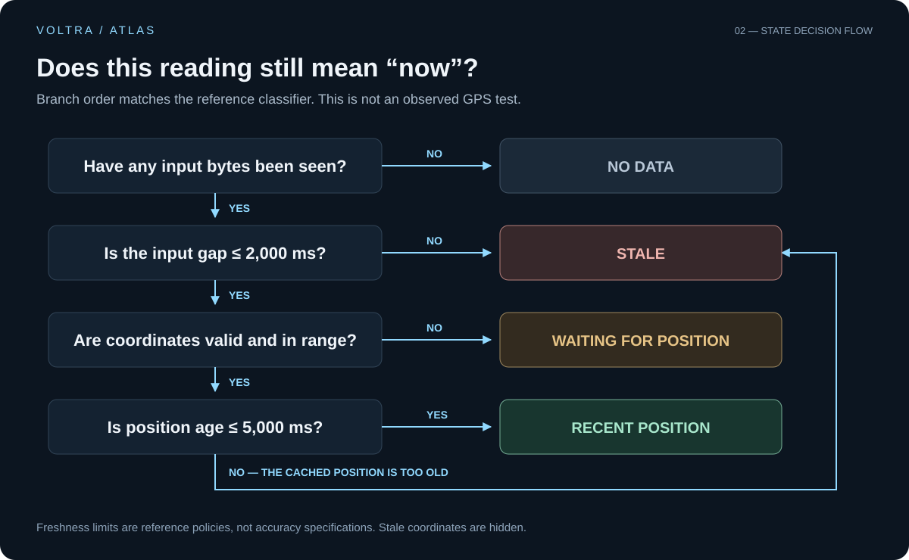

<h1 align="center">VOLTRA</h1>
<h2 align="center">ATLAS</h2>
<p align="center"><strong>GPS DATA DISPLAY · ESP8266 · EMBEDDED INTERFACES</strong></p>
<p align="center">A coordinate is useful only when you know how recent it is.</p>

<p align="center">
<a href="FIRMWARE.md">Build the reference</a> ·
<a href="docs/ENGINEERING.md">Explore the engineering</a> ·
<a href="WIRING_AND_SOURCE.md">Plan the connections</a> ·
<a href="BUILD_STATUS.md">Check the evidence</a>
</p>

## The prototype

**Atlas brings GPS receiver information to a compact, standalone screen.** The physical experiment combines a LoLin ESP8266 board, a receiver with a separate antenna, and a TFT labelled 1.8-inch / 128×160. Its engineering question is simple: how should a small device communicate not only a reading, but whether that reading is usable?

<table>
<tr>
<td width="50%"></td>
<td width="50%"></td>
</tr>
<tr>
<td><sub>01 / Controller and powered status display</sub></td>
<td><sub>02 / Receiver, antenna and physical integration</sub></td>
</tr>
</table>

**What is demonstrated:** a powered screen reading “SYSTEM: GPS TRACKING...” and “WAITING FOR FIX...”. Both photographs show the same owner-confirmed project. They do **not** establish satellite acquisition or positional accuracy. Images are genuine, full-frame derivatives—not generated hardware or digitally rearranged circuits.

## From bytes to a decision



The newly written reference firmware turns a data stream into an explicit status. [TinyGPSPlus](https://github.com/mikalhart/TinyGPSPlus) parses NMEA; the application checks location validity and age before allowing coordinates onto the optional display. A stream of bytes alone is never treated as a position.

| Design choice | What it changes |
| --- | --- |
| **Freshness before presentation** | A recent position, missing position and stale position produce different states. |
| **Bounded work per loop** | Input processing stops after 96 bytes; display updates are requested every 200 ms. These are code policies, not measured throughput. |
| **Explicit hardware adapters** | Receiver and TFT paths start disabled, with unset GPIOs. The code does not pretend to recover the photographed wiring. |

## Watch the idea

[](media/walkthrough.mp4)

[Open the illustrated video](media/walkthrough.mp4). This silent animation explains the reference concept; it is **not footage of the hardware operating** and contains no measured or personal location data.

## Four states. No hidden assumptions.



No input means **NO DATA**. Recent bytes without valid coordinates mean **WAITING FOR POSITION**. A valid position no older than 5 seconds, with input no older than 2 seconds, becomes **RECENT POSITION**. Older data become **STALE**, and coordinates are suppressed. These age limits are reference policies—not accuracy specifications or a claim of a continuous satellite fix.

## Start with the software

The original photographed sketch was not located. The included implementation is **new reference code**, not a recovered original or an already commissioned hardware driver.

```powershell
arduino-cli compile --fqbn esp8266:esp8266:nodemcuv2 firmware/gps_display
```

Install the documented dependencies first. The default build leaves physical peripherals disabled and accepts explicit USB NMEA replay on a compatible test board; no position is fabricated. **Compiling is not flashing.** See the [firmware guide](FIRMWARE.md) for setup, dependencies and the boundary between replay and real receiver input.

## Engineering record

| Resource | Inside |
| --- | --- |
| [Hardware inventory](BOM.md) | Visible components, quantities and unresolved model identities |
| [Engineering notes](docs/ENGINEERING.md) | Data path, state policy, timing choices and resource constraints |
| [Connections & commissioning](WIRING_AND_SOURCE.md) | What to identify, trace and test before enabling hardware |
| [Tests & limitations](BUILD_STATUS.md) | Actual compilation results, first-run state tests and the blocked repeat |
| [Reference source](firmware/gps_display/gps_display.ino) | Receive-only adapter, NMEA parsing and optional display path |

Two Arduino build variants passed. Seventeen state checks passed on the first native run; a later repeat was blocked by Windows Device Guard. **Real acquisition, UART/antenna behavior, accuracy and TFT operation remain untested.** No firmware was flashed. The [verification record](BUILD_STATUS.md) keeps those distinctions explicit.

### Next milestone

Demonstrate an actual first fix, a deliberate data interruption and recovery on this assembly. Confirm component identities and electrical connections, then compare against a reference before quoting accuracy. Do not publish home coordinates or private routes.

---

Built and documented for [ali9235](https://github.com/ali9235). **VOLTRA / ATLAS** is an independent hardware prototype with new reference software—not a cloud tracker or validated navigation instrument. No project-wide license has been selected; dependency licenses remain their own.
