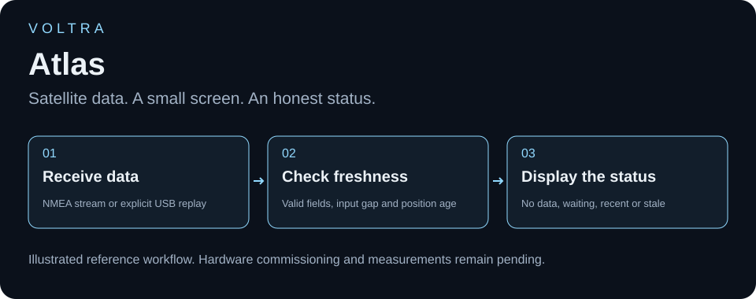

<h1 align="center">VOLTRA</h1>
<h2 align="center">Atlas</h2>

### Satellite data. A small screen. An honest status.

**Atlas** explores a simple embedded interface: make GPS receiver information readable on a small standalone display. The real breadboard prototype combines a **LoLin ESP8266 board, a GPS receiver module with a separate antenna, and a TFT labelled 1.8-inch / 128×160**. The owner confirms that both photographs belong to this single GPS data-display project.

The screen reads **“SYSTEM: GPS TRACKING...” / “WAITING FOR FIX...”**. That is evidence of a powered status display—not proof that a satellite position was acquired. No coordinates, accuracy, acquisition time or route-tracking result are invented.

## See the reference workflow

[Watch or download the 12-second illustrated explainer](media/walkthrough.mp4). The animation is an educational reference, not GPS test footage. It contains no actual location data.

## Engineering highlights

- A physical receiver-to-screen prototype, documented from two real photographs.
- New reference software separates **no data**, **waiting for a position**, **recent position** and **stale position** instead of presenting old coordinates as current.
- Bounded input processing and a timed display refresh keep the reference loop cooperative.
- Physical receiver/TFT adapters are disabled and GPIOs unset by default; no original pin map is guessed.

[New reference firmware and build steps](FIRMWARE.md) · [Connections and commissioning](WIRING_AND_SOURCE.md) · [Software verification](BUILD_STATUS.md)

## Hardware visible in the photographs

| Component | Quantity | Identification boundary |
| --- | --- | --- |
| LoLin ESP8266 development board | 1 | Exact board revision unconfirmed |
| GPS receiver breakout with u-blox-labelled shield | 1 | Exact model/revision, voltage and configured output require confirmation |
| Separate cabled antenna assembly | 1 | Active/passive type and RF specifications unconfirmed |
| TFT labelled 1.8-inch, 128×160 RGB | 1 | Driver/controller and actual pin assignments not established |
| Breadboard, jumper wires and USB connection | 1 assembly | Complete wiring cannot be traced reliably from these views |

## Two views, one project

The full frames are preserved with proportional resizing and metadata removal only. The photos are not generated or digitally rewired. They show the same GPS build; neither is assigned to the cooling repository.

## Software and evidence boundary

No matching original sketch was found in the searched Arduino, Desktop and existing firmware folders. Installed TinyGPS-related libraries and their examples are dependencies—not the owner's original implementation.

The newly authored reference uses [TinyGPSPlus](https://github.com/mikalhart/TinyGPSPlus) to parse supplied NMEA data. It can expose fresh position, time, satellite count, speed and altitude when those fields are valid; these are software capabilities, not demonstrated physical results. It neither transmits a location nor implements cloud tracking, navigation, geofencing or a GPS logger.

## Next physical demonstration

Confirm receiver model, serial output settings, logic levels, antenna and display driver. Record startup, the first valid position, loss of fresh data and recovery using the actual assembly. Retain a reference comparison before quoting accuracy. Keep home coordinates, precise routes and other private locations out of public screenshots and logs.

Project author: [ali9235](https://github.com/ali9235). Real hardware prototype with new reference software; physical commissioning and acquisition tests remain pending. No project-wide license selected.
