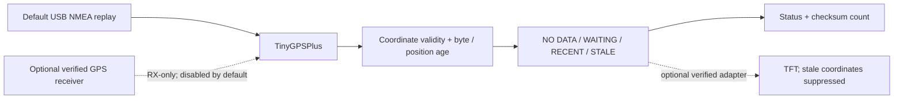

# VOLTRA Atlas: architecture and technical deep dive

Present receiver data with its validity and age. Coordinates should not look current merely because bytes keep arriving. Photos establish a powered waiting-for-fix screen, not a satellite position.

## System boundary

Solid arrows show implemented software flow or observed grouping. Dashed arrows identify optional, disabled or unverified paths. Neither is a recovered wiring schematic.

## Source and processing contract

| Layer | Source | Responsibility |
| --- | --- | --- |
| Configuration | [config.h](../firmware/gps_display/config.h) | Receiver/display gates and unset pin defaults |
| Policy | [status.h](../firmware/gps_display/status.h) | Four states and wrap-safe timing |
| Application | [gps_display.ino](../firmware/gps_display/gps_display.ino) | Ingestion, coordinate checks and rendering |
| Verification | [test_core.cpp](../tests/test_core.cpp) | Age/state boundary assertions |

TinyGPSPlus parses bytes. currentState(now) requires valid finite latitude/longitude within geographic bounds. classify checks whether input was ever received, byte age and location validity/age. Byte age over 2000 ms or position age over 5000 ms is stale. Tests cover exact state boundaries.

The loop consumes at most 96 bytes per iteration. Rendering is requested every 200 ms and reports every 1000 ms; these are policies, not measured throughput. Stale coordinates are hidden. Altitude, speed, satellite count and UTC fields have their own validity/age checks. Displaying six decimal places does not prove six-decimal accuracy.

Default input is USB NMEA replay. Optional SoftwareSerial is receive-only and sends no module configuration. No Wi-Fi tracker, map service or cloud API exists. Receiver identity, serial settings and actual TFT profile remain unconfirmed.

## Evidence boundary

No satellite acquisition, measured accuracy, antenna/RF result or actual TFT commissioning was established.

[Documentation index](ENGINEERING_STANDARD.md) · [Design decisions](DECISIONS.md) · [Security](../SECURITY.md)
